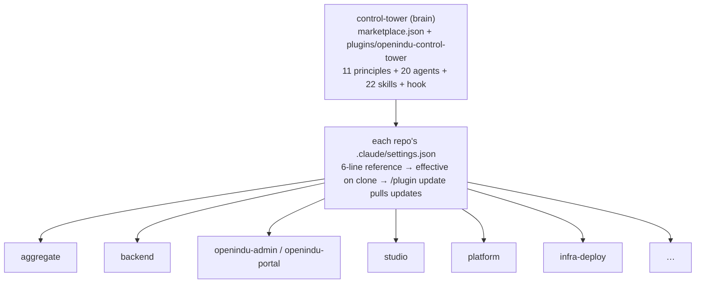

# openIndu Control Tower

This repo is the **control center (Control Tower)** of the openIndu community's AI end-to-end development workflow — an independent "brain" separate from business sub-repos. It maintains cross-repo routing, Agent behavior principles, and Agent prompts, and distributes workflows through Claude Code and Codex skill packages.

---

## Project positioning

| Position                           | Description                                                                                              |
| ---------------------------------- | -------------------------------------------------------------------------------------------------------- |
| **Brain**                          | Independent control repo; maintains `route.json` (repo locations/types/images/domains)                   |
| **Distribution hub**               | The public plugin `openindu-control-tower@openindu` ships principles, agents, skills, hooks to all repos |
| **Authoritative principle source** | `/principle` is every agent's Rule #1; the 11 RULEs are maintained by the openIndu community             |
| **Spec designer**                  | Feature designs in `spec/` get a first pass by control-tower, finalized after arbiter review             |

> Note: this repo is `control-tower` type, **not** `aggregate`. The aggregate repo handles submodule aggregation + image builds and is governed by this repo. The two are often confused.

---

## Repo types (abstraction)

The control layer **does not enumerate concrete repos**. This repo only defines repo **types and contracts**; concrete instances are data, queried at runtime via `/route`.

| Type               | Contract                                                                         |
| ------------------ | -------------------------------------------------------------------------------- |
| `control-tower`    | The sole source of principles, agent definitions, and the public plugin          |
| `aggregate`        | Submodule aggregation, drives image builds, relay in the delivery pipeline       |
| `backend`          | Server-side app, produces images, has a `.env.example` contract                  |
| `frontend`         | Static site, produces images, has a domain and nginx config                      |
| `gitops`           | The single home for K8s manifests; only this type may contain prod YAML (RULE 8) |
| Product-line types | `platform` / `tooling` / `application` / `edge`; release styles defined per type |

**Why no repo list**: the control layer enumerating downstream instances is a dependency inversion — adding a repo would force editing the brain's docs, so the brain ends up depending on the leaves. Types are abstractions (stable); instances are data (mutable).

> Adding a repo only requires a new entry in `plugins/openindu-control-tower/reference/route.json` + a `revision/` record — **this file stays untouched**. A new repo _type_ is the only case that touches this file, and that goes through `/spec-new`.

**Boundary note**: the `gitops`-type repo lives on Gitee; PR titles/bodies in English (RULE 9). All K8s manifest changes go through it (RULE 8).

---

## Distribution: Claude Code and Codex

Claude Code commands use `/name`. Codex skills use `$name` or the Codex skill picker; Codex does not register Claude-style slash commands. The root `.codex-plugin/plugin.json` packages the canonical skills for Codex plugin installation, while `.agents/skills/` provides repo-local discovery when this repository is open. The latter wrappers are generated from `plugins/openindu-control-tower/skills/` by `node scripts/sync-codex-skills.mjs --write`.



A sub-repo onboards by writing in `.claude/settings.json`:

```json
{
  "extraKnownMarketplaces": {
    "openindu": {
      "source": {
        "source": "github",
        "repo": "openIndu/control-tower"
      }
    }
  },
  "enabledPlugins": { "openindu-control-tower@openindu": true }
}
```

`/adopt` does this and lists duplicate governance assets for confirmation.

| Responsibility             | Where                                                                                     |
| -------------------------- | ----------------------------------------------------------------------------------------- |
| Maintain routing           | `plugins/openindu-control-tower/reference/route.json` (sole source); root is sync product |
| Maintain principles        | `plugins/openindu-control-tower/skills/principle/SKILL.md` (sole source of 11 RULEs)      |
| Maintain agent definitions | `plugins/openindu-control-tower/agents/*.md` (20 SDLC role agents, zero business binding) |
| Spec design + review       | `spec/` first-pass by control-tower → arbiter review                                      |
| Distribute assets          | Claude Code marketplace release and Codex plugin package version                          |
| Delivery pipeline          | RULE 11: sub-repo PR → merge → aggregate submodule → /build → gitops PR → apply           |

---

## Agent behavior hard constraints (11 RULEs速查)

| #   | Constraint                                                                 | RULE    |
| --- | -------------------------------------------------------------------------- | ------- |
| 1   | First step: call `/principle`                                              | RULE 1  |
| 2   | Local lint/format check before commit                                      | RULE 2  |
| 3   | Scripts > LLM > agent; escalate only as needed                             | RULE 3  |
| 4   | L2/L3 actions need human approval                                          | RULE 4  |
| 5   | Cross-repo changes via spec + arbiter                                      | RULE 5  |
| 6   | Completed artifacts不可变                                                  | RULE 6  |
| 7   | **No push to main/master** (plugin hook blocks)                            | RULE 7  |
| 8   | **K8s manifests only in infra-deploy**                                     | RULE 8  |
| 9   | **Gitee PR titles/bodies in English**                                      | RULE 9  |
| 10  | **Production SQL: multi-column WHERE + BEFORE/AFTER + conditional commit** | RULE 10 |
| 11  | **After fix: full PR→merge→submodule→image→apply**                         | RULE 11 |

> Full text: call `/principle`.

---

## Team structure (v5.0.0 — 20 SDLC role agents)

The public plugin provides a catalog of **20 role agents**. `/launch` activates a repo- and task-specific subset; it does not require all 20 agents to run for each task.

```mermaid
flowchart LR
    accTitle: SDLC Role Responsibilities
    accDescr: For /design, read-only codebase analysis is Phase 0 before research and product; route-selected implementation then receives independent local testing and human PR review. Other specialist roles are activated by scope.

    scan["codebase-analyst: Phase 0 for /design"] --> ba[business-analyst] --> pm[product-manager] --> architect[architect] --> ux[ui-ux-designer] --> builders[Route-selected build roles]
    builders --> test[test: UT/IT + local manual verification] --> human[Human PR review before merge]
```



| Domain     | Agents                                     |
| ---------- | ------------------------------------------ |
| Governance | manager, arbiter, inspector, control-tower |
| Ideation   | business-analyst, product-manager          |
| Design     | architect, ui-ux-designer                  |
| Build      | frontend, backend, edge, station-control   |
| Quality    | test, reviewer, security                   |
| Data       | data, bi-analyst                           |
| Operations | ops, release                               |
| Insight    | codebase-analyst                           |

All agents are pure role+skill, **zero business binding**. `/launch` selects the relevant subset by task, repo route, language, and modules. The diagram shows responsibilities and common handoffs; it does not imply every role runs sequentially for every task. `codebase-analyst` is mandatory Phase 0 for `/design`, otherwise read-only/on demand. For code changes, `test` owns UT/IT and local verification; `reviewer` provides optional pre-review but never replaces human PR review. Select `data` for production SQL/data repair and `security` for security-sensitive scope; operations, release, and metrics roles are scope-dependent. See [`plugins/openindu-control-tower/agents/`](./plugins/openindu-control-tower/agents/).

### Startup

```
/launch
```

Auto-detects team state: creates + spawns manager if absent; messages if manager is online. See [`team/STARTUP.md`](./team/STARTUP.md).

---

## Commands & workflows (22 skills)

Canonical instructions live at `plugins/openindu-control-tower/skills/<name>/SKILL.md`.
Use `/<name>` in Claude Code and `$<name>` (or the skill picker) in Codex. The
`disable-model-invocation` flag governs Claude Code behavior; Codex entrypoints
preserve explicit-only intent in their generated instructions. Load the
principles first: `/principle` in Claude Code, `$principle` or the canonical
principle file in Codex.

See the [README workflow map](./README.md#workflow-map) for Mermaid intake and
delivery diagrams. `/design` is phase-gated; eligible generic targets use
`/build` then `/publish`, while `openindu-website` uses its repo-local
`/release`. Production cluster apply is human-only.

### Reference (read-only, no writes)

| Command             | Input                          | Output                                                                                                                                                                                            |
| ------------------- | ------------------------------ | ------------------------------------------------------------------------------------------------------------------------------------------------------------------------------------------------- |
| `/principle` **\*** | none                           | the 11 RULEs loaded into context — no file write, no side effect                                                                                                                                  |
| `/route` **\***     | optional `<repo name or type>` | a routing answer read from `route.json` (URL / type / host / image / domain / aggregate ownership / K8s namespace) + 3 derived judgments (which PR flow, does it need `/build`, can it touch K8s) |

### SDLC pipeline orchestration

| Command      | Input                                            | Output                                                                                                                                                                                                                         |
| ------------ | ------------------------------------------------ | ------------------------------------------------------------------------------------------------------------------------------------------------------------------------------------------------------------------------------ |
| `/launch`    | optional `[initial task description]`            | the `openindu-maintainers` team brought up — manager spawned (or messaged if already up) with a role roster activated by the current repo's language; no file artifact, state lives in `~/.claude/teams/openindu-maintainers/` |
| `/design`    | `<feature description>`                          | The phase-gated 0-to-1 artifact workflow with mandatory UT/IT and local manual testing; UI/ops/BI phases are scope-dependent; ends with `/delivery-check`.                                                                     |
| `/autopilot` | `<idea> [--tier L0\|L1\|L2\|L3]`                 | the same artifact tree as `/design`, with a tiered STOP policy. L2/L3 deployment is available only when a verified non-production target and rollback path exist; the tier never relaxes review or RULE 4/7/8/10.              |
| `/design-md` | `[--pick <brand> \| --generate "<description>"]` | `design/uiux/DESIGN.md` — a 9-section design-system document (palette / type / components / layout / depth / do's-and-don'ts / responsive / agent-prompt guide) that becomes ui-ux-designer's and frontend's source of truth   |

### Workflow entrypoints (spec/010)

| Command           | Input                                             | Output                                                                                                                                                 |
| ----------------- | ------------------------------------------------- | ------------------------------------------------------------------------------------------------------------------------------------------------------ |
| `/research`       | `<openIndu/repo> <task-id> <question>`            | Evidence-backed competitor, roadmap and differentiation report with a go/pivot/stop decision                                                           |
| `/prod`           | `<openIndu/repo> <task-id>`                       | Scoped PRD, prioritized MVP and acceptance matrix for the same task                                                                                    |
| `/dev`            | `<openIndu/repo> <task-id>`                       | Implementation of one accepted task; hands its exact source SHA to `/test`                                                                             |
| `/test`           | `<openIndu/repo> <task-id>`                       | UT/IT results, locally started environment, manual verification and cleanup evidence                                                                   |
| `/dev_issue`      | `<openIndu/repo> [--dry-run] [--resume <run-id>]` | Enumerates one repository's Issues, runs research → prod → dev → test and stops at green PRs                                                           |
| `/publish`        | `<openIndu/repo> <task-id> [--dry-run]`           | Verified image and manifest change prepared as an English infra-deploy Gitee PR; production apply stays human-only                                     |
| `/pr_merge`       | `<openIndu/repo> [--dry-run]`                     | Serially merges that repository's eligible PRs after current approval, required checks and read-back                                                   |
| `/issue-pipeline` | `[--org openIndu] [--tier L1] [--dry-run]`        | Organization-scope issue collection, adversarial triage, and dispatch through applicable role-based SDLC or `/autopilot` to PR_GREEN; never merges PRs |

### Release & delivery (RULE 11)

| Command                  | Input                                      | Output                                                                                                                                                                                      |
| ------------------------ | ------------------------------------------ | ------------------------------------------------------------------------------------------------------------------------------------------------------------------------------------------- |
| `/build`                 | `<service-name> [--tag <tag>] [--dry-run]` | a Docker image built and pushed to the Aliyun Container Registry (RULE 11 step ④); `--dry-run` only validates the Dockerfile and pushes nothing                                             |
| `/delivery-check` **\*** | optional `[repo name or PR link]`          | a rendered 6-box RULE 11 checklist (① sub-repo PR → ⑥ `kubectl apply`) with ✅ / ⏳ / N/A per box and a Complete / Partially-complete verdict — a report returned to the thread, not a file |

### Governance & self-maintenance (control-tower repo)

| Command         | Input                                                                                                 | Output                                                                                                                                                                                                                                                       |
| --------------- | ----------------------------------------------------------------------------------------------------- | ------------------------------------------------------------------------------------------------------------------------------------------------------------------------------------------------------------------------------------------------------------ |
| `/adopt`        | `[--dry-run]` — operates on whatever repo the session is in, no repo argument                         | with `--dry-run`: a table only, zero writes; otherwise a PR against that repo adding the plugin reference to `.claude/settings.json`, rewriting Rule #1 to call `/principle`, plus a user-confirmed deletion list for duplicate governance assets            |
| `/spec-new`     | `<feature brief>`                                                                                     | `spec/NNN-brief-slug.md` (9 sections: background / design points / impact / phased path / rollback / acceptance / self-check / open questions / changelog), submitted to arbiter review; on approval, `status: finalized` + an index row in `spec/README.md` |
| `/revision-new` | `<change brief>`                                                                                      | `revision/YYYY-MM-DD-brief-slug.md` — a 4-section changelog record (summary / files involved / trigger / impact) with a 3-item verification checklist                                                                                                        |
| `/memory`       | `[--read <role> \| --add <role> "<lesson>"]` — also read implicitly by every agent at its own startup | read: a role's lesson text surfaced into context; write: one appended line in `team/communications/memory/<role>/{pitfalls,techniques}.md`                                                                                                                   |

### Standalone analysis

| Command                     | Input                                     | Output                                                                                                                                                                                                                                                                         |
| --------------------------- | ----------------------------------------- | ------------------------------------------------------------------------------------------------------------------------------------------------------------------------------------------------------------------------------------------------------------------------------ |
| `/codebase-analysis` **\*** | a target codebase (current repo or named) | one markdown report (`<ProjectName>分析报告.md`, project root), following the 7-step flow: problem → feature-to-problem map → components → code deep-dive → architecture → 4+1 views → doc                                                                                     |
| `/company-analysis` **\***  | a company name or description             | one markdown company-profile report — either the full 11-section report or the compact recurring "每日公司观察" variant; business-analyst's market/competitor-research tool, oriented toward openIndu's own technical-community domain when the audience is engineering-facing |

---

## Directory structure

```
control-tower/
├── README.md
├── README_ZH.md                      # Chinese version
├── AGENTS.md                          # this file
├── route.json                        # sync product (sole source in the plugin)
├── .claude/settings.json            # references the public plugin
├── .claude-plugin/marketplace.json  # marketplace catalog
├── plugins/openindu-control-tower/       # ★ canonical skills and Claude Code plugin
│   ├── .claude-plugin/plugin.json
│   ├── skills/                      # 22 canonical workflows shared by both clients
│   ├── agents/                      # 20 agents (SDLC roles, zero business binding)
│   ├── evals/                       # workflow-execution regression suite
│   ├── hooks/                       # trunk protection (RULE 7)
│   ├── reference/                   # route.json (sole source) + manifest.yaml + coding-standards/
│   └── README.md
├── .agents/skills/                   # Codex repo-local discovery entrypoints (generated)
├── .codex-plugin/plugin.json         # Codex plugin manifest
├── scripts/                          # sync-route / check-roster / check-version-bump / detect-modules
├── .github/workflows/ci.yml         # prettier + plugin validate + route + roster consistency
├── spec/                            # feature designs (control-tower design → arbiter review)
├── revision/                        # change records (changelog)
└── team/                            # team docs + comms threads
```

---

## Hooks

The trunk-protection hook is built into the public plugin (`plugins/openindu-control-tower/hooks/`); repos with the plugin get it automatically.

| Hook            | Event                          | Effect                                     |
| --------------- | ------------------------------ | ------------------------------------------ |
| Block push main | `PreToolUse` (Bash/PowerShell) | exit 2 blocks push to main/master (RULE 7) |

Repos may add repo-specific hooks (e.g. `PostToolUse` auto-lint) in their own `.claude/settings.json`; no conflict with the plugin hook.

---

## Pre-submit checks

```bash
npx prettier --check "**/*.md"
claude plugin validate ./plugins/openindu-control-tower --strict
node scripts/sync-route.mjs --check
node scripts/check-roster.mjs
```

All four run in CI on PR (`.github/workflows/ci.yml`).

> After editing plugin content, bump `version` in `plugin.json` and `marketplace.json`, or downstream `/plugin update` won't pick it up.
