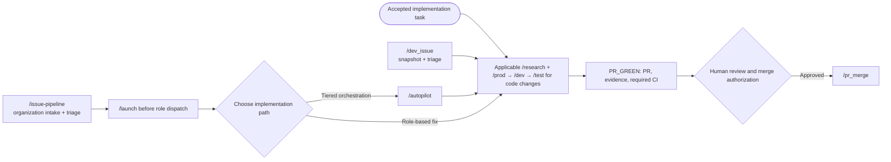
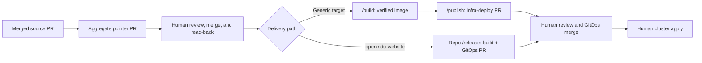

# openIndu — Control Tower

> **Language:** English | [中文](README_ZH.md)

> The **control center** of the openIndu community's AI end-to-end development workflow — an independent "brain" separate from business repos. It maintains cross-repo routing, Agent behavior principles, and Agent prompts, and distributes workflows through Claude Code and Codex skill packages.

---

## Quick start

In any openIndu repo:

```bash
/plugin marketplace add openIndu/control-tower
/plugin install openindu-control-tower@openindu
```

Or more thoroughly — run `/adopt` once in the target repo. It writes the plugin reference into `.claude/settings.json`, points Rule #1 at `/principle`, and lists duplicate principle copies and governance agents for you to confirm deletion.

Available immediately after onboarding:

| Command                     | Purpose                                                                                         |
| --------------------------- | ----------------------------------------------------------------------------------------------- |
| `/principle`                | Load the 11 Agent behavior principles (Rule #1)                                                 |
| `/route`                    | Look up repo location, image, domain, which PR flow to use                                      |
| `/launch`                   | Bring up the `openindu-maintainers` team                                                        |
| `/design`                   | Orchestrate the 0-to-1 SDLC pipeline across roles                                               |
| `/autopilot`                | Run the pipeline at a chosen autonomy tier (L0-L3)                                              |
| `/design-md`                | Adopt a DESIGN.md design system for UI work                                                     |
| `/memory`                   | Read/write the team's reusable lessons ledger                                                   |
| `/delivery-check`           | Self-check the RULE 11 delivery pipeline completeness                                           |
| `/adopt`                    | Onboard a repo and converge duplicate governance assets                                         |
| `/issue-pipeline`           | Collect and triage open issues across the whole org                                             |
| `/pr_merge <openIndu/repo>` | Inspect and serially merge eligible PRs with current approval, strict required CI and read-back |
| `/dev`                      | Implement one accepted task and hand off its exact source SHA to `/test`                        |
| `/research`                 | Market and competitor research with evidence-backed differentiation and experiments             |
| `/prod`                     | Define the scoped product requirements, MVP and acceptance matrix                               |
| `/test`                     | Run UT/IT, start the local app, manually verify acceptance and retain evidence                  |
| `/publish`                  | Prepare and reconcile an infra-deploy Gitee release PR from a verified immutable image          |
| `/dev_issue`                | Process one repo's Issues through research, product, development, testing and green PRs         |
| `/spec-new`                 | Draft a new spec (feature / process / principle change)                                         |
| `/revision-new`             | Create a revision record (changelog) for a change                                               |
| `/build`                    | Build and push a Docker image for an openIndu service (RULE 11 step 4)                          |
| `/codebase-analysis`        | Reverse-engineer and document an unfamiliar codebase                                            |
| `/company-analysis`         | Research and profile a company — business-analyst's market/competitor-research tool             |
| `/retro`                    | Consolidate session errors into durable lessons; governance gaps become proposals, not edits    |
| `/git-commit-push`          | Commit, push and open a PR under the repository's own rules                                     |
| `/cleanup`                  | Session close-out: file deliverables, fix references, delete throwaways after confirmation      |

Plus **20 agents** (governance / ideation / design / build / quality / data / operations / insight, zero business binding) and a hook that blocks `git push origin main`.

### Workflow map

- **One accepted task:** `/research` → `/prod` → `/dev` → `/test`. Keep the same repo and task ID; each stage consumes the previous artifact/checkpoint.
- **Issue to green PR:** `/dev_issue <repo>` triages one repo's Issues and runs the accepted items through those stages; it stops at PR_GREEN and does not merge.
- **Organization intake:** `/issue-pipeline` compares the API-visible repository list with canonical GitHub repos in `route.json`, then collects and adversarially triages the authorized openIndu scope; inventory gaps block dispatch. Accepted work goes through `/autopilot` or the applicable role-based fix flow; it stops before merging.
- **Feature design:** `/launch` before `/design` for the phase-gated role pipeline, or `/autopilot` when a tiered STOP policy is appropriate. Run evidence stays in an isolated task directory; committed design docs are versioned copies linked by path and hash. L2/L3 changes workflow STOP points only; every PR still needs current human review and required checks before merge.
- **Delivery:** `/pr_merge <repo>` merges only individually eligible PRs with current approval and required CI. `/build` requires a registered image target in `/route`; `/publish` prepares the infra-deploy PR. Cluster apply remains human-only.

**Client entrypoints:** use `/dev` in Claude Code. Codex discovers the same workflow as `$dev` or in its skill picker through `.agents/skills/` when this repo is open, or through the Codex plugin manifest when the plugin is installed. Codex does not register Claude-style `/dev` slash commands.

The entrypoints converge on the same evidence-backed code-change stages;
routine fixes may record research/product applicability as not applicable.
Intake, merge, and delivery remain separate boundaries:



After merge, image build and GitOps publication are separate delivery steps.
Production apply remains a human operation:



This diagram is for image-backed aggregate services. Independent release flows
and submodule-only repos follow their `/route` contract; `/build` stops when no
image target is registered, and `/publish` requires a matching GitOps manifest.

---

## Core positioning

```
        ┌──────────────────────────────────┐
        │  openIndu Control Tower          │
        │      (this repo — the brain)     │
        │                                  │
        │  · plugins/openindu-control-tower/    │
        │      ├─ 11 principles (sole src)│
        │      ├─ 20 SDLC role agents     │
        │      ├─ 25 workflow skills      │
        │      └─ trunk-protection hook   │
        │  · route.json (repo routing, data)│
        │  · spec/ revision/ design & change│
        └────────────┬─────────────────────┘
                     │ plugin distribution (/plugin update)
                     │
        ┌────────────┴────────────┐
        ▼                         ▼
   any openIndu repo        decided by route.json
   (agents by role+language) (adding a repo never touches the brain)
```

The dependency direction is **one-way**: downstream depends on the control layer's abstractions (principles, agent responsibilities, workflow); the control layer never depends on downstream concrete instances.

| Position                           | Description                                                                                                  |
| ---------------------------------- | ------------------------------------------------------------------------------------------------------------ |
| **Brain**                          | Maintains repo-type contracts and agent role definitions; concrete instances are data in `route.json`        |
| **Distribution hub**               | The public plugin `openindu-control-tower@openindu` ships principles, agents, skills, and hooks to all repos |
| **Authoritative principle source** | `/principle` is every agent's Rule #1; the 11 RULEs are maintained by the openIndu community                 |
| **Spec designer**                  | Feature designs in `spec/` get a first pass by control-tower, then finalized after arbiter review            |

---

## Repo types (abstraction)

The control layer **does not enumerate concrete repos**. This repo only defines repo **types and contracts**; which repos exist, what their images/domains are — that's data, queried at runtime via `/route`.

| Type               | Contract                                                                         |
| ------------------ | -------------------------------------------------------------------------------- |
| `control-tower`    | The sole source of principles, agent definitions, and the public plugin          |
| `aggregate`        | Submodule aggregation, drives image builds, relay in the delivery pipeline       |
| `backend`          | Server-side app, produces images, has a `.env.example` contract                  |
| `frontend`         | Static site, produces images, has a domain and nginx config                      |
| `gitops`           | The single home for K8s manifests; only this type may contain prod YAML (RULE 8) |
| Product-line types | `platform` / `tooling` / `application` / `edge`; release styles defined per type |

> **Why the repo list was removed**: the control layer enumerating downstream instances is a dependency inversion — adding a repo would force editing the brain's docs, so the brain ends up depending on the leaves. Types are abstractions (stable); instances are data (mutable).
>
> Adding a repo only requires a new entry in `plugins/openindu-control-tower/reference/route.json` + a `revision/` record — **this file stays untouched**. The table above only changes when a brand-new repo _type_ appears, and that goes through `/spec-new`.

**Boundary note**: the `gitops`-type repo lives on Gitee; its PR titles/bodies use English (RULE 9). All K8s manifest changes must go through it (RULE 8).

---

## Agent behavior principles (11)

Call `/principle` for the full text. Summary:

| RULE | Title                                                                                           |
| ---- | ----------------------------------------------------------------------------------------------- |
| 1    | Principles first (call `/principle` as the first step)                                          |
| 2    | Engineering fundamentals first (CI / tests / security scanning must pass before agents)         |
| 3    | Automation first (scripts > LLM; only escalate to the level just sufficient)                    |
| 4    | Human-AI collaboration tiers (L0–L3 authorization matrix + the three "ables")                   |
| 5    | Validate · Review · Collaborate · Secure (eval/trace/CODEOWNERS/least-privilege)                |
| 6    | Completed artifacts are immutable (threads/specs/templates can't be edited before confirmation) |
| 7    | Git trunk protection (no push to main; everything via PR)                                       |
| 8    | K8s manifests belong only in infra-deploy                                                       |
| 9    | Gitee PR titles/bodies in English                                                               |
| 10   | Production SQL: multi-column WHERE + BEFORE/AFTER + conditional commit                          |
| 11   | After a fix, run the full delivery pipeline (PR→merge→submodule→image→apply)                    |

---

## Team structure (v5.0.0 — 20 SDLC role agents)

The public plugin provides a catalog of **20 role agents**. `/launch` activates a repo-specific subset based on the task, route, languages, and modules; the catalog is not 20 agents that must all run for every task.

```mermaid
flowchart LR
    accTitle: SDLC Role Responsibilities
    accDescr: The 0-to-1 feature path starts with read-only codebase analysis, then moves through research, product, design, route-selected implementation, required local testing, and human review. Other specialists are selected by scope and risk.

    scan["codebase-analyst<br/>Phase 0 for /design; read-only"] --> research[business-analyst] --> product[product-manager] --> architecture[architect] --> ux[ui-ux-designer] --> build["Route-selected build role(s)"]
    build --> test[test: UT/IT + local manual verification] --> human[Human PR review before merge]
```



This is the 0-to-1 path; `codebase-analyst` owns `/design` Phase 0 and is
otherwise on demand. Enhancements use a codebase check and architecture
delta; one-off fixes record research/product applicability and still require
testing; research-only requests stop at the business decision. `reviewer` can
pre-review a PR but never replaces required human review.

| Domain     | Agent                | Core responsibility                                                               |
| ---------- | -------------------- | --------------------------------------------------------------------------------- |
| Governance | **manager**          | Classify/dispatch/track tasks; resolve ordinary workflow exceptions within policy |
| Governance | **arbiter**          | Cross-repo arbitration, spec review                                               |
| Governance | **inspector**        | Proactive inspection                                                              |
| Governance | **control-tower**    | Principles / routing / agent definitions / plugin                                 |
| Ideation   | **business-analyst** | Market research, competitor analysis, business case                               |
| Ideation   | **product-manager**  | Requirements, PRDs, acceptance criteria, contracts                                |
| Design     | **architect**        | Tech selection, system architecture, ADRs                                         |
| Design     | **ui-ux-designer**   | Interaction, visual, design system, accessibility                                 |
| Build      | **frontend**         | React / Vue / UniApp (zero business binding)                                      |
| Build      | **backend**          | Spring Boot / FastAPI (zero business binding)                                     |
| Build      | **edge**             | Rust / field-protocol drivers                                                     |
| Build      | **station-control**  | C# / .NET / physical devices (default L3)                                         |
| Quality    | **test**             | UT/IT, local startup and manual acceptance; RULE 2 admission gate                 |
| Quality    | **reviewer**         | RULE 5.2 four-lens pre-review                                                     |
| Quality    | **security**         | RULE 5.4 credentials / permissions / exposure                                     |
| Data       | **data**             | RULE 10 production-SQL protection                                                 |
| Data       | **bi-analyst**       | Metrics, dashboards, experimentation                                              |
| Operations | **ops**              | Day-2 ops: server/db/logs/runbooks                                                |
| Operations | **release**          | RULE 11 six-stage delivery + K8s manifests                                        |
| Insight    | **codebase-analyst** | Reverse-engineer/onboard to any repo (read-only)                                  |

For code changes, the test role owns UT/IT and local verification. The `data` role is selected for production SQL/data repair; `security` for security-sensitive scope; `release` for applicable RULE 11 delivery. Governance, codebase analysis, reviewer pre-review, operations, and metrics roles join only when their scope applies. Definitions and each specialist's scope are in [`plugins/openindu-control-tower/agents/`](./plugins/openindu-control-tower/agents/). All agents are pure role+skill, **zero business binding**. The diagram shows common handoffs, not a requirement to activate every seat. Agent pre-review does not replace the human review required before merge.

### Startup

```
/launch
```

Auto-detects team state: creates + spawns manager if absent; sends a message if manager is already online. See [`team/STARTUP.md`](./team/STARTUP.md).

---

## Directory structure

```
control-tower/
├── README.md
├── README_ZH.md                      # Chinese version
├── AGENTS.md                          # Shared agent instructions
├── route.json                        # Sync product (sole source in the plugin)
├── .claude/settings.json            # References the public plugin
├── .claude-plugin/marketplace.json  # Marketplace catalog
├── plugins/openindu-control-tower/       # ★ Canonical workflow and Claude Code plugin
├── .agents/skills/                       # Codex discovery entrypoints (generated)
├── .codex-plugin/plugin.json             # Codex plugin package manifest
│   ├── .claude-plugin/plugin.json
│   ├── skills/                      # 25 skills: principle / adopt / launch / design / autopilot / memory / design-md / delivery-check / route / spec-new / revision-new / codebase-analysis / build / company-analysis / dev / dev_issue / prod / publish / research / test / issue-pipeline / pr_merge / retro / git-commit-push / cleanup
│   ├── agents/                      # 20 agents (SDLC roles, zero business binding)
│   ├── evals/                       # workflow-execution regression suite
│   ├── hooks/                       # Trunk protection
│   ├── reference/                   # route.json + manifest.yaml + coding-standards/
│   └── README.md
├── scripts/                          # sync-route / check-roster / check-version-bump / detect-modules
├── .github/workflows/ci.yml
├── spec/                            # Feature designs
├── revision/                        # Change records
└── team/                            # Team docs + comms threads
```

---

## Maintenance & evolution

- **Edit a principle**: only edit `plugins/openindu-control-tower/skills/principle/SKILL.md`; go through `/spec-new` → arbiter review → `/revision-new` → PR
- **Edit routing**: only edit `plugins/openindu-control-tower/reference/route.json`, then `node scripts/sync-route.mjs`
- **Add an agent**: create a file under `plugins/openindu-control-tower/agents/` → register in `reference/manifest.yaml` → update listings → bump version
- **Add a skill**: create `plugins/openindu-control-tower/skills/<name>/SKILL.md` → bump version
- **Refresh Codex entrypoints**: run `node scripts/sync-codex-skills.mjs --write` after changing canonical skills
- **Release**: after edits, bump `version` in both `plugin.json` and `marketplace.json`, otherwise downstream `/plugin update` won't pick it up
- **PR enforced**: this repo is protected by RULE 7; the plugin hook blocks pushes to main

Run before submitting:

```bash
npx prettier --check "**/*.md"
claude plugin validate ./plugins/openindu-control-tower --strict
node scripts/sync-route.mjs --check
node scripts/check-roster.mjs
```

---

## Contributing

- Workflow pain points / improvement proposals: file an issue in this repo
- Principle additions: go through `/spec-new` + PR
- Agent behavior tweaks: edit `plugins/openindu-control-tower/agents/*.md`, open a PR
- New skill: create `plugins/openindu-control-tower/skills/<name>/SKILL.md`, open a PR

All changes go through PR; pushing directly to main is forbidden.

---

## License

[Apache License 2.0](LICENSE) — matches the `license` field already declared in
`plugins/openindu-control-tower/.claude-plugin/plugin.json`, and is consistent with the
Apache-2.0 licensing of the other openIndu core repos.
