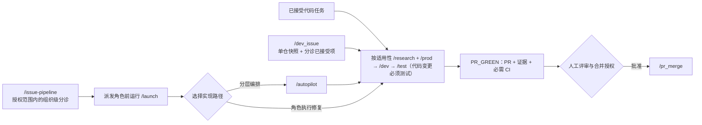
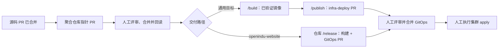
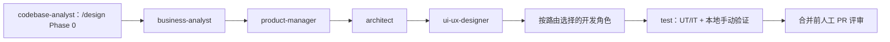

# openIndu — Control Tower

> **语言 / Language:** [English](README.md) | 中文

> openIndu 社区 AI 端到端开发流程的**管控中心**——独立于业务仓库的"大脑"，维护各仓库路由信息、Agent 行为守则、Agent prompt，并以 **Claude Code 插件**的形式把这些资产分发给全组织所有仓库。

---

## 快速接入

在任意 openIndu 仓库中：

```bash
/plugin marketplace add openIndu/control-tower
/plugin install openindu-control-tower@openindu
```

或者更彻底——在目标仓跑一次 `/adopt`，它会把插件引用写进 `.claude/settings.json`、把 Rule #1 指向 `/principle`、并列出该仓内重复的守则副本与治理 agent 供你确认删除。

接入后立刻可用：

| 命令                        | 作用                                                                    |
| --------------------------- | ----------------------------------------------------------------------- |
| `/principle`                | 加载 11 条 Agent 行为守则（Rule #1）                                    |
| `/route`                    | 查仓库位置、镜像、域名、走哪种 PR                                       |
| `/launch`                   | 拉起 `openindu-maintainers` 团队                                        |
| `/design`                   | 编排 0→1 SDLC 角色流水线                                                |
| `/autopilot`                | 分层自主跑流水线（L0-L3）                                               |
| `/design-md`                | 采用 DESIGN.md 设计系统做 UI                                            |
| `/memory`                   | 读写团队可复用踩坑记忆                                                  |
| `/delivery-check`           | RULE 11 交付链路完成度自检                                              |
| `/adopt`                    | 让某个仓接入并收敛重复治理资产                                          |
| `/issue-pipeline`           | 扫描并分类全组织的 open issue                                           |
| `/pr_merge <openIndu/repo>` | 仅合入当前 head 已获人工批准且必需 CI 全绿的 PR，并逐个回读结果         |
| `/dev`                      | 针对一个已确认任务进行开发，并将确切源码 SHA 交给 `/test` 验证          |
| `/research`                 | 调研同类产品、路线与证据支持的差异化机会                                |
| `/prod`                     | 明确产品需求、MVP 范围和验收矩阵                                        |
| `/test`                     | 执行 UT/IT、启动本地环境、手动验证并保留证据                            |
| `/publish`                  | 基于不可变镜像准备并核对 infra-deploy Gitee 发布 PR                     |
| `/dev_issue`                | 遍历单仓库 Issue，依次完成调研、产品定义、开发、测试并提交通过 CI 的 PR |
| `/spec-new`                 | 起草新 spec（特性/流程/守则变更）                                       |
| `/revision-new`             | 为一次改动创建变更记录（changelog）                                     |
| `/build`                    | 为 openIndu 服务构建并推送镜像（RULE 11 第④步）                         |
| `/codebase-analysis`        | 逆向分析并整理一个陌生代码库                                            |
| `/company-analysis`         | 调研分析一家公司——business-analyst 的市场/竞品研究工具                  |

外加 **20 个 agent**（治理/需求/设计/构建/质量/数据/运维/洞察，零业务绑定）和一个阻断 `git push origin main` 的 hook。

### 工作流关系

- **单个已确认代码任务：** `/research` → `/prod` → `/dev` → `/test`。各阶段使用相同仓库和 task ID，按前序产物与 checkpoint 交接；小型修复可将调研或产品定义记为有证据的不适用。
- **Issue 到绿灯 PR：** `/dev_issue <repo>` 只处理指定仓库的 Issue；已接受条目依次经过上述阶段，达到 PR_GREEN 后停止，不负责合并。
- **组织级 Issue 入口：** `/issue-pipeline` 将 API 可见仓库与 `route.json` 中的 GitHub 仓库清单核对；存在缺失或多余仓库时停止派发，再对授权的 openIndu 范围做对抗式分诊。接受的任务交给 `/autopilot` 或相应角色执行；不负责合并。
- **功能设计：** `/launch` 后运行逐阶段设有人类停止点的 `/design`；运行证据保存在隔离的 task 目录，需入库的设计文档以带版本的副本提交，并在任务证据中记录路径和 hash。`/autopilot` 的 L2/L3 只调整流程停止点，不自动合并；所有 PR 仍需当前人工评审和必需检查。
- **交付：** `/pr_merge <repo>` 只合并逐个满足当前人工批准和必需 CI 的 PR。`/build` 要求 `/route` 注册镜像目标；`/publish` 准备 infra-deploy PR；集群 apply 仍由人工执行。

**客户端入口：** Claude Code 中使用 `/dev`；Codex 中通过 `$dev` 或 skill picker 调用同一工作流。本仓打开时由 `.agents/skills/` 提供项目级发现；将 Codex 插件安装到其他仓库后也可使用。Codex 不会把这些 skill 注册为 Claude 风格的 `/dev` slash command。

各入口的受理范围、停止点和交付边界不同：



合并后，镜像构建与 GitOps 发布是独立交付步骤；生产集群 apply 由人工执行：



此图仅描述有镜像目标的聚合服务。独立发布和仅 submodule 的仓库遵循各自 `/route` 契约；未登记镜像目标时 `/build` 会停止，`/publish` 也必须存在对应 GitOps manifest。

---

## 核心定位

本仓库是**独立管控层**，不属于任何业务子仓：

| 定位            | 说明                                                                                 |
| --------------- | ------------------------------------------------------------------------------------ |
| **大脑**        | 维护仓库类型契约与 agent 角色定义；具体实例是 `route.json` 里的数据                  |
| **分发中心**    | 公共插件 `openindu-control-tower@openindu` 把守则、agent、skill、hook 下发到所有仓库 |
| **权威守则源**  | `/principle` 是所有 agent 的 Rule #1，11 条 RULE 由 openIndu 社区维护                |
| **spec 设计者** | `spec/` 的特性设计由 control-tower 完成第一轮，提交 arbiter 审核后定稿               |

依赖方向是**单向的**：下游依赖管控层的抽象（守则、agent 职责、流程），管控层不依赖下游的具体实例。

---

## 仓库类型（抽象）

管控层**不枚举具体仓库**。本仓只定义仓库的**类型与契约**；具体有哪些仓、镜像是什么、域名是什么，是数据——运行时用 `/route` 查询。

| 类型            | 契约                                                              |
| --------------- | ----------------------------------------------------------------- |
| `control-tower` | 守则、agent 定义、公共插件的唯一源                                |
| `aggregate`     | submodule 聚合，驱动镜像构建，交付链路的中继                      |
| `backend`       | 服务端应用，产出镜像，有 `.env.example` 契约                      |
| `frontend`      | 静态站点，产出镜像，有域名与 nginx 配置                           |
| `gitops`        | K8s 清单唯一归口，仅此类型可含生产 YAML（RULE 8）                 |
| 产品线类型      | `platform` / `tooling` / `application` / `edge`，发布方式各自定义 |

> 新增仓库只需在 `plugins/openindu-control-tower/reference/route.json` 加一条 + 写 `revision/`，**不改本文件**。

**边界提醒**：`gitops` 类型的仓在 Gitee 上，PR 标题/正文用英文（RULE 9）；所有 K8s 清单变更必须经它（RULE 8）。

---

## Agent 行为守则（11 条）

调用 `/principle` 获取完整正文。简表：

| RULE | 标题                                                   |
| ---- | ------------------------------------------------------ |
| 1    | 规则前置（启动第一步调用 `/principle`）                |
| 2    | 工程基础先行（CI / 测试 / 安全扫描达标才放 agent）     |
| 3    | 自动化优先（脚本 > LLM，只升到刚好满足那一级）         |
| 4    | 人机协作分级（L0-L3 授权矩阵 + 三可）                  |
| 5    | 验证·评审·协作·安全（eval/trace/CODEOWNERS/最小权限）  |
| 6    | 已完成产出物不可变（threads/spec/模板未确认禁止改）    |
| 7    | Git 主干保护（main 禁 push，全走 PR）                  |
| 8    | K8s 清单归口 infra-deploy                              |
| 9    | Gitee PR 标题/正文用英文                               |
| 10   | 生产 SQL 多列 WHERE + BEFORE/AFTER + 条件 commit       |
| 11   | 修复后完整走完交付链路（PR→合并→submodule→镜像→apply） |

---

## 团队架构（v5.0.0 — 20 个 SDLC 角色 agent）

公共插件提供 **20 个角色 agent**。`/launch` 根据任务、路由、语言和模块激活相应子集，并不表示每项任务都要同时运行全部 20 个 agent。



| 域   | Agent                | 核心职责                                   |
| ---- | -------------------- | ------------------------------------------ |
| 治理 | **manager**          | 任务分配、进度跟踪、策略例外决策           |
| 治理 | **arbiter**          | 跨仓仲裁、spec 审核                        |
| 治理 | **inspector**        | 主动巡检                                   |
| 治理 | **control-tower**    | 守则 / 路由 / agent 定义 / 公共插件        |
| 需求 | **business-analyst** | 市场调研、竞品分析、商业案例               |
| 需求 | **product-manager**  | 需求、PRD、验收标准、跨仓契约              |
| 设计 | **architect**        | 技术选型、系统架构、ADR                    |
| 设计 | **ui-ux-designer**   | 交互、视觉、设计系统、无障碍               |
| 构建 | **frontend**         | React / Vue / UniApp（零业务绑定）         |
| 构建 | **backend**          | Spring Boot / FastAPI（零业务绑定）        |
| 构建 | **edge**             | Rust / 现场协议驱动                        |
| 构建 | **station-control**  | C# / .NET / 物理设备（默认 L3）            |
| 质量 | **test**             | UT/IT、本地启动与手动验收；RULE 2 准入门槛 |
| 质量 | **reviewer**         | RULE 5.2 四视角预审                        |
| 质量 | **security**         | RULE 5.4 凭证 / 权限 / 暴露面              |
| 数据 | **data**             | RULE 10 生产 SQL 防护                      |
| 数据 | **bi-analyst**       | 指标、看板、实验                           |
| 运维 | **ops**              | 服务器/DB/日志/运行手册                    |
| 运维 | **release**          | RULE 11 六段交付 + K8s 清单                |
| 洞察 | **codebase-analyst** | 逆向/onboarding 任意仓（只读）             |

代码变更由 test 角色负责 UT/IT 与本地验证；`codebase-analyst` 是 `/design` 必需的 Phase 0，其余场景按需只读启用。生产 SQL/数据修复时选用 `data`，安全敏感变更时选用 `security`，适用的 RULE 11 交付由 `release` 负责。PR 准备阶段可由 `reviewer` 预审，但不能代替合并前的人工评审。治理、运维和指标角色按各自范围加入。箭头表示常见交接，不是每个任务都必须经过的固定流水线。开发角色由 `route.json` 的语言/模块决定，多语言仓库可启用多个角色。各专项角色的职责见 [`plugins/openindu-control-tower/agents/`](./plugins/openindu-control-tower/agents/)。所有 agent 纯角色+技能，**零业务绑定**。

### 启动

```
/launch
```

自动检测团队状态：不存在则创建 + spawn manager；已存在且 manager 在线则直接发消息。详见 [`team/STARTUP.md`](./team/STARTUP.md)。

---

## 目录结构

```
control-tower/
├── README.md
├── README_ZH.md                      # 中文版
├── AGENTS.md                        # Shared agent instructions
├── route.json                       # 同步产物（唯一源在插件内）
├── .claude/settings.json            # 引用公共插件
├── .claude-plugin/marketplace.json  # 市场目录
├── plugins/openindu-control-tower/       # ★ canonical skills 和 Claude Code 插件
├── .agents/skills/                       # Codex 本地发现入口（生成文件）
├── .codex-plugin/plugin.json             # Codex 插件 manifest
│   ├── .claude-plugin/plugin.json
│   ├── skills/                      # 22 个 skill：principle / adopt / launch / design / autopilot / memory / design-md / delivery-check / route / spec-new / revision-new / codebase-analysis / build / company-analysis / dev / dev_issue / prod / publish / research / test / issue-pipeline / pr_merge
│   ├── agents/                      # 20 个 agent（SDLC 角色，零业务绑定）
│   ├── evals/                       # workflow-execution 回归评估
│   ├── hooks/                       # 主干保护
│   ├── reference/                   # route.json + manifest.yaml + coding-standards/
│   └── README.md
├── scripts/                          # sync-route / check-roster / check-version-bump / detect-modules
├── .github/workflows/ci.yml
├── spec/                            # 特性设计
├── revision/                        # 修订记录
└── team/                            # 团队文档 + 通信 threads
```

---

## 维护与演进

- **改守则**：只改 `plugins/openindu-control-tower/skills/principle/SKILL.md`，走 `/spec-new` → arbiter 审核 → `/revision-new` → PR
- **改路由**：只改 `plugins/openindu-control-tower/reference/route.json`，然后 `node scripts/sync-route.mjs`
- **新增 agent**：在 `plugins/openindu-control-tower/agents/` 建文件 → 注册进 `reference/manifest.yaml` → 更新清单 → bump version
- **新增 skill**：在 `plugins/openindu-control-tower/skills/<name>/SKILL.md` 建目录 → bump version
- **同步 Codex 入口**：修改 canonical skill 后运行 `node scripts/sync-codex-skills.mjs --write`
- **发版**：改完 bump `plugin.json` 与 `marketplace.json` 的 `version`，下游才能 `/plugin update` 拿到
- **强制 PR**：本仓库受 RULE 7 保护，插件 hook 会阻断 push main

提交前跑：

```bash
npx prettier --check "**/*.md"
claude plugin validate ./plugins/openindu-control-tower --strict
node scripts/sync-route.mjs --check
node scripts/check-roster.mjs
```

---

## 贡献方式

- 流程断点 / 改进提案：在本仓 issue 中提
- 守则补充：走 `/spec-new` + PR
- agent 行为优化：编辑 `plugins/openindu-control-tower/agents/*.md`，提 PR
- 新增 skill：创建 `plugins/openindu-control-tower/skills/<name>/SKILL.md`，提 PR

所有变更走 PR 流程，禁止直接 push main。
