# /design — SDLC pipeline orchestration

Drives a 0-to-1 feature through the SDLC role pipeline. Each phase writes its canonical, versioned evidence to the task-isolated state root; the next phase reads that exact artifact. When the user needs design documents committed to the repository, publish named copies under `design/<domain>/` and record each repository path and content hash in the task evidence. STOP points at every phase handoff by default; `/autopilot` can relax conversation STOPs but never merge gates.

**Call `/principle` first** (RULE 1).

---

## Autopilot mode

If invoked via `/autopilot <idea> --tier L<n>`, the STOP policy changes by tier:

- **L0** (prod/irreducible): every phase STOP (default behavior).
- **L1** (feature branch): STOP at phase 1 + final delivery; build/test/review auto-run between.
- **L2** (staging): one STOP at the staging candidate; any merge still requires current human review, required checks and separate authorization before GitOps sync.
- **L3** (sandbox): no phase STOPs; a PR still needs current human review and required checks before merge, and deployment needs a verified disposable sandbox with authorization and rollback.

RULE 4 (L3 risk actions), RULE 7 (no push to main), RULE 8 (K8s in gitops), RULE 10 (prod SQL) are **never** suspended by any tier. See `/autopilot`.
Every PR still requires current human review and required checks before merge at every tier; autopilot never merges it.

---

## 0. Codebase pre-check (before any design)

**Invoke `codebase-analyst` BEFORE the ideation/design phases** to scan the target repo for existing implementations of the requested feature. This prevents "designing something that already exists" (pilot finding #1 from openindu-website 2026-08-05).

| What codebase-analyst does                                                                     | Canonical output                   |
| ---------------------------------------------------------------------------------------------- | ---------------------------------- |
| Scans the target repo (via `/route`) for existing endpoints/files/modules matching the feature | `<task-dir>/codebase-scan-v<N>.md` |

| Result                            | Pipeline adjustment                                                                                                                                                                                             |
| --------------------------------- | --------------------------------------------------------------------------------------------------------------------------------------------------------------------------------------------------------------- |
| **Found existing implementation** | Switch from 0-to-1 to **enhancement flow** (step 1, row 2). The business-analyst/product-manager/architect phases work on the DELTA (what's missing from the existing implementation), not a greenfield design. |
| **Found partial implementation**  | Scope = fill the gap. Architect reads the existing code's patterns + conventions (response format, router style, etc.) before proposing changes.                                                                |
| **Not found**                     | Proceed with the normal 0-to-1 pipeline.                                                                                                                                                                        |

🛑 **STOP at L0/L1**: show the pre-check result to the user; confirm scope (enhance vs new build) before proceeding. At L2/L3: auto-adjust scope, note in thread, proceed.

---

## Task execution contract

Use `reference/workflow-execution.md` for every task. Pass a task ID and exact
versioned artifact paths to each role. Canonical evidence stays under the task
directory in the shared state root; never use shared `design/<domain>/` paths
as runtime handoffs or select a shared "latest" input. Repository design docs
are optional deliverables: publish an explicitly requested, versioned copy
under `design/<domain>/`, then record its repository path and SHA-256 in the
canonical task report. The task report/checkpoint records the hash of that
mapping, preserving an auditable link to both copies. Verify the committed copy
at its commit SHA before marking the phase complete.
All request types, including one-off fixes and enhancements, must record
research/prod applicability, development and independent test evidence.
After development, the test role runs UT/IT and starts the local environment
for interactive acceptance and cleanup. Missing verification blocks PR creation.

## The pipeline

```mermaid
flowchart LR
    accTitle: 0-to-1 Feature Design and Build
    accDescr: The 0-to-1 design workflow checks the codebase, moves through research and product definition into applicable architecture and UI design, selects implementation roles by repository route, and requires independent local testing before the delivery completeness check.

    scan["Phase 0: codebase-analyst<br/>read-only scope scan"] --> research["Phase 1: business-analyst<br/>research-v1.md"]
    research --> product["Phase 2: product-manager<br/>prod-v1.md"] --> architecture["Phase 3: architect<br/>architecture + ADRs"]
    architecture --> ux["Phase 4: ui-ux-designer<br/>when applicable"] --> build["Phase 5: route-selected build role(s)<br/>code + applicable design artifacts"]
    build --> test["Phase 6: test<br/>UT/IT + local startup + manual acceptance"]
    test --> delivery["/delivery-check<br/>RULE 11 completeness"]
```



`codebase-analyst` can be invoked at **any** phase for read-only insight on unfamiliar code (it never edits).
The `ops` role adds runbooks/topology when the task needs operations design;
`bi-analyst` adds metrics/dashboard artifacts only when measurement is in scope.
This diagram is the 0-to-1 path. Enhancements start from the codebase check,
product manager, and an architecture delta; one-off fixes record research and
product applicability and still require testing; research-only requests stop
at the business decision. If a PR is prepared, `reviewer` can provide a
four-lens pre-review, which never replaces human PR review.

## 1. Classify the request

| Request type                    | Flow                                                                                                           |
| ------------------------------- | -------------------------------------------------------------------------------------------------------------- |
| 0-to-1 feature (new capability) | Phase 0 pre-check → if not found, full pipeline                                                                |
| Enhancement to existing feature | Phase 0 pre-check → product-manager → architect (delta) → build → test → applicable ops/BI → `/delivery-check` |
| One-off fix                     | Record research/prod applicability ? dev ? test ? PR; then /delivery-check                                     |
| Research / "should we build X"  | Stop at business-analyst; don't proceed to build without a decision                                            |

If the request is vague, STOP and clarify with the user before starting.

## 2. Run each phase (with STOP points)

For each phase:

1. `manager` spawns the role agent (background, `repo=` param).
2. The role agent:
   - calls `/principle`
   - calls `/route`
   - reads its own role memory (`/memory`, `team/communications/memory/<role>/`)
   - reads the exact prior phase artifact from the task directory
   - writes a new versioned canonical artifact to that task directory
   - when a repository design deliverable is requested, writes a versioned
     repository copy and records its path and SHA-256 in the canonical artifact
   - **self-verifies** (build roles: build → self-test → self-review → verify) before reporting done
   - writes a completion_report to `team/communications/threads/{task-id}/`
3. 🛑 **STOP** — show the artifact to the user; confirm before the next phase.

```
For feature: <description>
  □ Phase 0: codebase-analyst → <task-dir>/codebase-scan-v<N>.md [🛑 confirm scope]
  □ Phase 1: business-analyst → <task-dir>/research-v1.md   [🛑 confirm]
  □ Phase 2: product-manager → <task-dir>/prod-v1.md            [🛑 confirm]
  □ Phase 3: architect → <task-dir>/architecture-v<N>.md + optional versioned ADR copy [🛑 confirm]
  □ Phase 4: ui-ux-designer → <task-dir>/uiux-v<N>.md + optional versioned repo copy [🛑 confirm]
  □ Phase 5: route-selected build roles → code + task evidence [🛑 confirm]
  □ Phase 6: test → UT/IT + local startup + manual acceptance evidence        [🛑 confirm]
  □ Phase 7: ops → <task-dir>/ops-v<N>.md (when applicable; optional repo copy) [🛑 confirm]
  □ Phase 8: bi-analyst → <task-dir>/bi-v<N>.md (when applicable; optional repo copy) [🛑 confirm]
  □ /delivery-check — RULE 11 completeness                                   [🛑 confirm]
```

## 3. Phase skip rules

- Skip an optional phase only when its input or scope does not apply (e.g. skip ui-ux-designer for a pure backend/API feature, or ops/BI artifacts when out of scope); record the reason in the thread.
- Never skip Phase 6 testing for implementation work: UT/IT, local startup, manual acceptance, and evidence are required before PR creation.
- Never skip business-analyst + product-manager for a 0-to-1 feature — that's the whole point.
- architect can be a delta review for enhancements (read existing architecture, produce only the delta ADR).

## 4. Handoff contract

Each phase's artifact is the next phase's input. If a phase can't proceed (ambiguous input), it STOPS and requests the prior phase revise — don't guess forward. Max 2 revision rounds, then escalate to `manager`.

## 5. Completion

Pipeline done = all applicable phase artifacts exist + build produces working code + mandatory local test evidence exists + `/delivery-check` shows RULE 11 completeness. Present the task evidence index, any committed design deliverables, the change list and delivery checklist to the user.

## Boundary

`/design` orchestrates; it does not write artifacts itself (the role agents do). It does not replace `/launch` (which spawns manager + activates the roster) — `/design` is the workflow manager runs once the team is up.

## Two-repo PR flow (submodule architecture)

When the target repo is a **submodule** of an aggregate repo (e.g. `openindu-backend` under `openindu-website`):

- Canonical task evidence remains in the shared state root. User-approved **repository design deliverables** commit to the **aggregate** repo (e.g. `openindu-website/design/`) as versioned copies; record their paths and hashes in the canonical task evidence.
- **Code changes** commit to the **submodule** repo (e.g. `openIndu-backend/`) → submodule PR.
- After the submodule PR merges, the **aggregate** repo needs a submodule pointer update PR (RULE 11 step ③).
- Two PRs total (submodule code + aggregate pointer) — this is inherent to the submodule architecture, not a bug. `manager` coordinates both.

## Change log

- 2026-11-03: Bound handoffs to task artifacts and added mandatory test/Issue gates.
- 2026-11-03: Added the independent local test phase and clarified conditional specialist phases.
- 2026-11-03: Scoped the diagram and mandatory handoffs by request type; kept agent pre-review distinct from the /design phase gate.
- 2026-11-03: Separated task-isolated evidence from optional committed design deliverables and bound copies by path and SHA-256.
