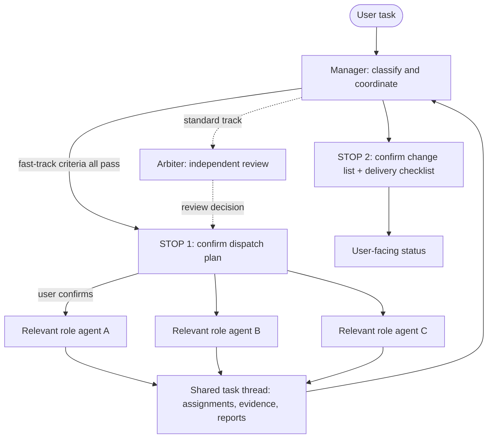
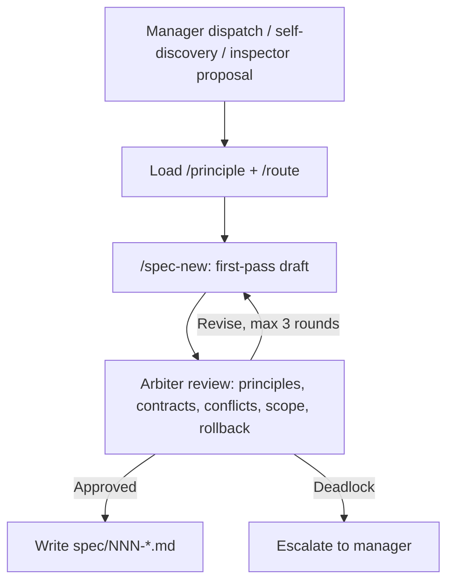

# Team — openIndu SDLC role pipeline

The governance assets (principles, agent definitions, manifest) live in the public plugin `plugins/openindu-control-tower/` for org-wide zero-copy reuse.

`team/` now holds: this file, [`principle.md`](./principle.md) (pointer), [`STARTUP.md`](./STARTUP.md) (startup guide), and runtime `communications/`.

## Where assets live

| Asset                 | Location                                                   | How to use                     |
| --------------------- | ---------------------------------------------------------- | ------------------------------ |
| 11 principles         | `plugins/openindu-control-tower/skills/principle/SKILL.md` | `/principle`                   |
| 20 agents             | `plugins/openindu-control-tower/agents/*.md`               | `@openindu-control-tower:<id>` |
| Team manifest         | `plugins/openindu-control-tower/reference/manifest.yaml`   | read by manager                |
| Routing               | `plugins/openindu-control-tower/reference/route.json`      | `/route`                       |
| Team startup          | `plugins/openindu-control-tower/skills/launch/SKILL.md`    | `/launch`                      |
| Trunk-protection hook | `plugins/openindu-control-tower/hooks/`                    | auto-effective                 |

## Core principles

| Principle                            | Note                                                                                                                |
| ------------------------------------ | ------------------------------------------------------------------------------------------------------------------- |
| **Rule #1: `/principle`**            | Every agent loads `/principle` first; re-load every 20 steps or after compaction                                    |
| **Pure role, zero business binding** | Agents hold only role+skill; business binding in `route.json` + repo `AGENTS.md` (legacy `CLAUDE.md` fallback only) |
| **Single source**                    | Principles and routing each have one source file; no repo self-hosts copies                                         |
| **Pre-spawn sync + check**           | Every agent: ① `/principle` ② `git pull origin main` ③ `git status`                                                 |
| **Clear escalation**                 | Cross-repo conflict → arbiter; policy exception → manager                                                           |

## Team architecture

The public plugin contains 20 role definitions; `/launch` selects the relevant
subset for the repo and task. Team members do not spawn other teammates. The
manager coordinates work, while each role owns its own scope and reports through
the task thread. The arbiter is a review role, not a manager subordinate in the
SDLC delivery chain.

Sub-agents do not communicate with one another directly; coordination and
evidence aggregation use Markdown files under
`team/communications/threads/{task-id}/`. Parallel dispatch is appropriate only
for independent work. The manager flow has two user confirmation gates: STOP 1
before role-agent dispatch, and STOP 2 before final delivery reporting.
Fast-track tasks skip arbiter review only when every published criterion passes;
other tasks use standard arbiter review before STOP 1. `/design` also has
phase-level confirmations by default; `/autopilot` applies its documented tier
policy without relaxing RULE 4/7/8/10 or human PR review.

## Agent roster (v5.0.0 — 20 SDLC roles)

| Domain     | Agent(s)                                      |
| ---------- | --------------------------------------------- |
| Governance | manager / arbiter / inspector / control-tower |
| Ideation   | business-analyst / product-manager            |
| Design     | architect / ui-ux-designer                    |
| Build      | frontend / backend / edge / station-control   |
| Quality    | test / reviewer / security                    |
| Data       | data / bi-analyst                             |
| Operations | ops / release                                 |
| Insight    | codebase-analyst                              |

```mermaid
flowchart LR
    accTitle: SDLC Role Handoffs
    accDescr: The /design feature path begins with read-only codebase analysis, then hands off from research through product and design to route-selected implementation, required independent testing, and human PR review.

    scan["codebase-analyst: Phase 0 for /design"] --> ba[business-analyst] --> pm[product-manager] --> architect[architect] --> ux[ui-ux-designer] --> build[Route-selected build roles]
    build --> test[test: UT/IT + local manual verification] --> human[Human PR review before merge]
```

The arrows show common handoffs, not a universal fixed sequence. The build
seat is selected from `route.json` by language/modules; one or more seats may
be needed in a multi-language repo. UT/IT and local verification are required
for code implementation. Human review is mandatory before merge; the agent
`reviewer` seat offers optional pre-review when appropriate. `codebase-analyst`
is mandatory in `/design` Phase 0, and otherwise read-only/on demand.
Governance roles coordinate or review when the task requires them; security is
activated for relevant risks; `data` covers production SQL/data repair; `ops`
and `bi-analyst` produce scope-specific artifacts; `release` owns applicable
RULE 11 delivery stages. Definitions in
[`../plugins/openindu-control-tower/agents/`](../plugins/openindu-control-tower/agents/).
All are pure role+skill, zero business binding.

## Spec design flow

## Comms protocol

Inter-agent communication goes through markdown files in `team/communications/threads/{task-id}/`.

| File                       | Direction             | Note                        |
| -------------------------- | --------------------- | --------------------------- |
| `001-review_request.md`    | manager → arbiter     | Pre-dispatch review request |
| `002-review_decision.md`   | arbiter → manager     | approved/rejected           |
| `003-task_assignment.md`   | manager → role agent  | Specific task dispatch      |
| `004-completion_report.md` | role agent → manager  | Completion report           |
| `005-revision_request.md`  | manager → role agent  | Quality-gate return         |
| `00N-escalation.md`        | any → arbiter/manager | Conflict escalation         |
| `00N-proposal.md`          | inspector → manager   | Improvement proposal        |

## Adding an agent

1. Create `plugins/openindu-control-tower/agents/<name>.md` with YAML frontmatter (`name` / `role` / `description`, + `design_dir`/`languages` as applicable)
2. Register in `reference/manifest.yaml` under `agents:`
3. Add a row in this file's roster + the plugin README's Agents table
4. bump `plugin.json` version
5. `claude plugin validate ./plugins/openindu-control-tower --strict`
6. PR (RULE 7)

Structure: role definition → startup prerequisites → skills → techniques → design-doc workflow → capability indicators → behavior constraints → escalation.
